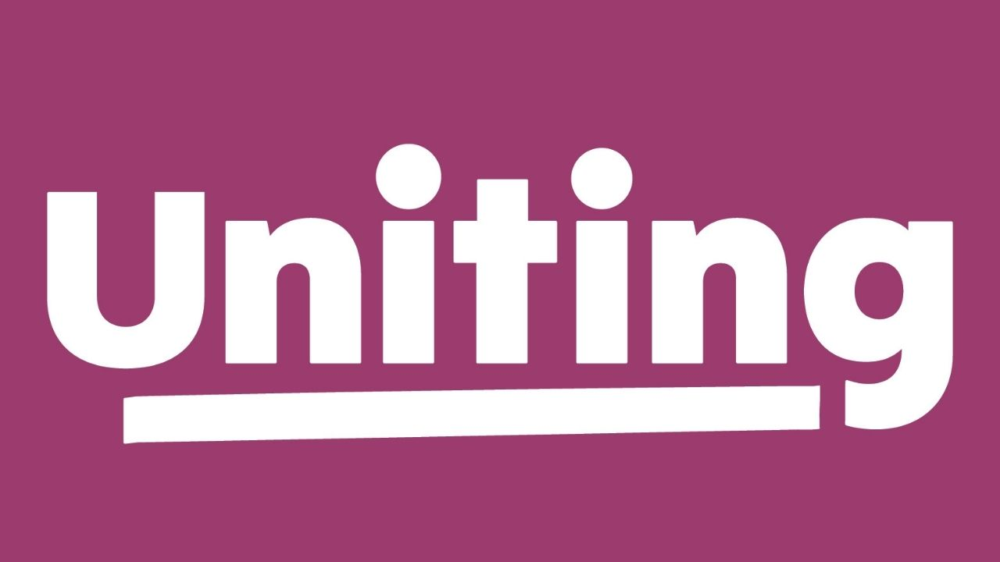

This year's datathon will use data from Uniting, Australian's largest not-for-profit aged care network.   

## The Context

Uniting support almost 8,000 seniors across Residential Aged Care homes across NSW and the ACT. These facilities are assessed for quality and compliance through a rigorous national regulatory framework managed by the [Aged Care Quality and Safety Commission (ACQSC)](https://www.agedcarequality.gov.au/). The ACQSC monitors homes through a continuous accreditation cycle that includes site audits, unnanounced visits and assessment grading via the Star Rating System.

## The Star Rating System

Assessment outcomes are integrated into a 1 to 5 Star Rating published transparently on the federal government's [My Aged Care Find a Provider](https://www.myagedcare.gov.au/) portal. The rating is determined by four key categories:

* **Compliance** (30% weight): Calculated daily based on the home's performance in recent ACQSC audits and any active regulatory decisions.
* **Residents’ Experience** (33% weight): Derived from independent, annual consumer satisfaction surveys filled out by the residents themselves.
* **Staffing** (22% weight): Measures whether the home meets its mandated targets for care minutes provided by Registered Nurses, enrolled nurses, and personal care assistants.
* **Quality Measures** (15% weight): Evaluates clinical data submitted quarterly regarding indicators like pressure injuries, physical restrictive practices, unplanned weight loss, falls, and medication management.

## The Challenge

Using historical data, your team must develop and validate an early warning system forecasting homes with low star ratings. You will have access to rich information including clinical outcomes, customer surveys, operational metrics and workforce indicators. The challenge is how to combine this information to predict poor Star outcomes. Your solution will also need to be transparent and explainable to stakeholders.     

